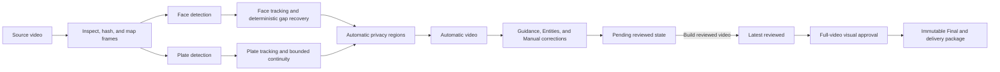

# Video Redaction Pipeline

Video Redaction Pipeline is a local, reviewable workflow for turning source video into privacy-redacted media while preserving the evidence and human decisions behind the result.

The current automated detection and tracking scope is exactly two sensitive-object
categories: faces and license plates.

- `face`;
- `license_plate`.

The review UI can also store manually drawn `other_sensitive` correction
geometry, but that is a human review/correction category only, not an automated
detector or tracker category.

Its central design principle is:

> A detector proposal is evidence, not a final privacy decision.

Real video contains motion blur, low light, occlusion, scale changes, scene cuts, and targets that briefly leave the frame. Reliable redaction therefore requires more than running a detector on independent images. This project combines source-bound inference, temporal tracking, bounded gap recovery, explicit reviewer policy, manual geometry correction, validated rendering, and an auditable finalization process.

## What the system does

For each video case, the pipeline can:

1. inspect and hash the source video;
2. detect faces and license plates;
3. associate detections into temporal tracks;
4. recover only defensible short gaps and surface uncertain intervals for review;
5. render an **Automatic** redacted video;
6. let a reviewer confirm, reject, reclassify, or correct the result;
7. build a source-bound **Latest reviewed** revision from the accumulated review state;
8. require a full-video visual approval of that exact revision;
9. publish an immutable **Final** video and delivery manifest.

The repository is intended for local operation. Source videos, model weights, review sessions, generated media, and delivery packages normally live under ignored artifact directories rather than in Git.

## System at a glance



Face and plate detection remain category-specific because the two object types have different geometry and temporal behavior. After detection and tracking, both categories are represented through shared privacy-region, review, rendering, and provenance contracts.

## End-to-end workflow

### 1. Establish source identity

The pipeline records the source frame count, resolution, frame rate, duration, and cryptographic identity. Review decisions and corrections are stored in source-frame coordinates so they cannot silently drift to another derivative video.

### 2. Detect sensitive objects

The supported face path uses the selected OpenVINO ADAS face detector. The selected plate path uses the repository's YOLOv9-S-608 license-plate model.

Raw detections remain separate from later tracking, recovery, policy, and manual correction records. A recovered or manually drawn region is never relabeled as a direct detector hit.

### 3. Track evidence over time

Frame-level observations are linked into temporal targets. Tracks make it possible to maintain continuity, identify gaps, reduce flicker, and review one object over an interval instead of rediscovering it frame by frame.

### 4. Recover bounded gaps

Detector misses are expected. The face pipeline uses deterministic, source-bound recovery from trusted temporal anchors. Long or ambiguous recovered intervals remain review guidance instead of being silently accepted as automatic truth.

The plate path accumulates evidence over time and uses bounded continuity rules. Sparse or ambiguous plate proposals remain reviewable rather than becoming confident tracks merely because interpolation is possible.

### 5. Render Automatic media

Accepted machine privacy regions are rendered into the **Automatic** video. Automatic is a review input, not a final claim.

The Automatic result remains immutable relative to its detector, tracking, recovery, and configuration inputs. Human review creates a separate reviewed state rather than rewriting the original machine evidence.

## Review Workspace

The Final Review Workspace is a local browser application served by the Python backend.

It exposes four media roles when available:

- **Original** — the source video;
- **Automatic** — machine-generated redaction;
- **Latest reviewed** — the newest validated render of the current review state;
- **Final** — an immutable approved publication.

### Guidance

Guidance highlights intervals that deserve attention, such as possible tracking drift, uncertain identity continuity, plate coverage risk, or optional spot checks.

Guidance is advisory. A reviewer may inspect and adjudicate it, but unreviewed Guidance alone does not fabricate a Correct decision and does not block finalization. The mandatory full-video review remains the final protection against silent misses outside targeted Guidance.

### Needs correction

**Needs correction** is fail-closed. It means the current reviewed geometry or policy is not acceptable. A case cannot publish a current Latest reviewed revision or Final while a real Needs correction blocker remains unresolved.

### Entities

Entities are source-backed, privacy-conservative groupings of people and plates assembled from temporal evidence. They help a reviewer apply case policy consistently, but they are advisory review objects rather than open-ended identity recognition.

Entity-level actions apply to the whole selected entity, not only the thumbnail currently visible in the interface.

Typical actions are:

- **Redact** — include the entity in reviewed privacy regions;
- **Keep visible** — deliberately preserve the entity;
- **Not a person / Not a plate** — reject the entity as a false proposal;
- **Needs review** — leave the entity unresolved.

Entity actions are powerful and should be used carefully. The workspace surfaces entity purity/conflict information and requires human confirmation for candidate merges, but the reviewer remains responsible for checking the entity's full interval. If one entity accidentally contains both false-positive and true-positive evidence, marking the entire entity as Not a person or Not a plate can remove valid redaction regions. The reviewer should inspect the entity's full interval and verify the rebuilt Latest reviewed video before approval.

### Manual correction

Manual correction adds explicit source-frame privacy geometry without changing detector thresholds or rewriting automatic evidence.

Supported modes are:

- **Single frame** — exactly one rectangle on one source frame;
- **Fixed interval** — one fixed rectangle applied across an interval;
- **Interpolate** — explicit start and end rectangles with linear interpolation between them.

The correction lifecycle is intentionally batched:

1. draw a correction;
2. preview the affected frame or short interval;
3. save the correction record, or remove an individual saved correction when it should no longer apply;
4. continue adding or editing other corrections;
5. select **Build reviewed video** once when the review changes are ready to materialize.

Manual Preview is local and short: it renders only the draft frame or interval needed to verify the correction before Save.

Saving or removing a correction stores authoritative review state and marks reviewed media as pending when pixels change. It does **not** normally trigger a full reviewed-video render after every rectangle. Multiple Manual corrections and media-affecting Entity actions can be accumulated before the reviewer explicitly selects **Build reviewed video**. The explicit build applies all pending corrections and media-affecting entity changes in one reviewed-video job.

If the reviewed state is identical to Automatic, the build can reuse the validated Automatic media instead of running a full encode.

### Building Latest reviewed

**Build reviewed video** compiles the current case policy, entity actions, and saved corrections into a reviewed-region set, renders or safely reuses media, validates the result, and publishes a new immutable Latest reviewed revision.

While changes are pending:

- the previous Latest may remain historical but is not current for the new state;
- full-video approval is unavailable;
- Final creation remains blocked.

A new edit made during a build does not silently become part of an older job. Outdated jobs are superseded, and only media bound to the latest compatible review state can become current.

### Full-video approval and Final

After Latest reviewed is current, the reviewer watches the complete video and records a full-video approval bound to that exact revision, media hash, reviewed-region identity, case, and session.

Final creation requires:

- a current validated Latest reviewed revision;
- no active Needs correction or invalid correction state;
- a current full-video approval bound to that revision;
- valid source, session, lineage, media, and reviewed-region identities.

Final is immutable. Later review changes create new revisions; they do not rewrite an existing Final.

## Review sessions and safety

Review sessions are append-only and hash-chained. Durable decisions live on the server, not in browser storage.

The workspace provides:

- case-scoped decisions and corrections;
- explicit case/session routing for review actions;
- atomic JSON and pointer updates;
- strict event-chain validation;
- a single-writer lock so the same workspace cannot be edited by two writable servers at once;
- concurrent-safe, case-safe persistence of reviewer decisions;
- frame-accurate seeking in source-frame coordinates;
- individual correction retraction;
- on-demand entity previews with background caching;
- entity purity/conflict handling and human-confirmed candidate merges;
- stale-publication protection for reviewed-video materialization;
- historical preservation of superseded Latest, sweep, and Final artifacts;
- explicit **New review session** and case reset actions.

**Reset this case to Automatic baseline** is destructive for the selected case's active review state. It should be used deliberately.

## What the output package contains

A finalized case delivery package contains:

- `Original.mp4`;
- `Automatic.mp4`;
- `Latest_reviewed.mp4`;
- `Final.mp4`;
- a portable manifest;
- a review-audit record;
- `reviewed_regions.jsonl` with the packaged per-redaction records;
- `redaction_manifest.json` with source, revision, count, and hash bindings;
- validation state.

The manifest binds the package to its source hash, case, session, reviewed-region identity, media hashes, and current Final state. Package media and audit metadata can therefore be checked without relying on local absolute paths.

## Auditability and provenance

The system records enough information to reconstruct why a region exists and which output contains it.

| Layer | Examples of recorded information |
| --- | --- |
| Source | metadata, frame mapping, cryptographic identity |
| Model evidence | active model identities and workflow configuration |
| Temporal evidence | tracks, intervals, observations, gaps, and review signals |
| Region provenance | detection, tracking, deterministic recovery, entity policy, or manual correction |
| Human review | Guidance decisions, entity actions, corrections, reset history, and full-video approval |
| Rendering | reviewed-region set, media identity, validation results, and revision pointers |
| Finalization | exact Latest revision, approval binding, integrity gates, and immutable Final identity |

Portable delivery packages include the authoritative `reviewed_regions.jsonl` for the packaged Latest/Final revision, plus a `redaction_manifest.json` with source, case, revision, record-count, semantic-hash, and file-hash bindings. Detector confidence is preserved where available; tracked, recovered, entity-policy, and manual regions do not fabricate confidence values.

The audit trail is intended to answer not only "what was redacted?" but also "why was it redacted, what changed during review, and which exact media revision contains that decision?"

## Evaluation and claims

The project keeps different claim layers separate:

1. **Detector evaluation** — whether the selected model directly proposed the target on scored frames;
2. **Automatic coverage** — whether machine tracking and recovery produced privacy regions;
3. **Reviewed-final geometric evaluation** — whether authoritative reviewed regions match a compatible frozen benchmark;
4. **Human full-video review** — whether the exact current reviewed video was watched and approved.

These layers are not interchangeable. Manual corrections and recovered regions do not improve raw detector recall, and a full-video approval is evidence of human review rather than a numerical metric.

Important limits:

- numerical evaluation is source-bound and cannot be transferred to a different clip or incompatible source lineage;
- the current Day product Final is not numerically comparable to the frozen Day plate benchmark source;
- face reviewed-final numerical scoring is not supported by the frozen face evaluation contract;
- the complete product videos do not carry a mathematical or global zero-leak certification;
- visual review remains authoritative when geometric metrics and visible privacy disagree.

See [docs/EVALUATION.md](docs/EVALUATION.md) for the exact frozen evaluation evidence and limitations.

## Production-readiness work

The repository includes production-oriented safeguards for local operation:

- deterministic face gap recovery;
- source- and revision-bound review state;
- immutable revision pointers;
- event projection and media metadata caching;
- no-op and reusable materialization paths;
- explicit batched reviewed-video builds;
- supersession of outdated media jobs;
- heavy-job admission control;
- resumable stage manifests;
- streaming validation to reduce memory use;
- structured timing and integrity telemetry.

Detection and full-video rendering remain the expensive stages. Manual Preview and Save are designed to stay responsive, while full reviewed-video encoding is an explicit background operation.

## Quick start

### Requirements

- Python 3.11 or 3.12;
- FFmpeg and FFprobe;
- Node.js and npm;
- local model weights.

### Install

```bash
python -m venv .venv
source .venv/bin/activate
python -m pip install -e ".[dev]"
redactor doctor
```

Build the frontend:

```bash
npm --prefix frontend ci
npm --prefix frontend run build
```

### Run an automatic face-and-plate case

```bash
redactor redact-video path/to/input.mp4 \
  --categories face,license_plate \
  --adas-xml models/face-detection-adas-0001/face-detection-adas-0001.xml \
  --adas-bin models/face-detection-adas-0001/face-detection-adas-0001.bin \
  --plate-model models/open-image-models/yolo-v9-s-608-license-plates-end2end.onnx \
  --output-dir path/to/output_case \
  --overwrite
```

The output directory contains source-bound automatic artifacts and media. When a review workspace has been generated, serve it with:

```bash
redactor serve-final-review-workspace path/to/review_workspace --open
```

Only one writable server should be run for a given workspace.

## Testing

```bash
npm --prefix frontend run build
npm --prefix frontend test -- --run
PYTHONDONTWRITEBYTECODE=1 .venv/bin/python -m ruff check .
PYTHONDONTWRITEBYTECODE=1 .venv/bin/python -m pytest -rs -p no:cacheprovider
REDACTOR_RUN_FIREFOX_E2E=1 PYTHONDONTWRITEBYTECODE=1 .venv/bin/python -m pytest -rs -p no:cacheprovider tests/test_final_review_workspace_firefox.py
git diff --check
```

Exact test counts and release hashes belong in [docs/RELEASE_EVIDENCE.md](docs/RELEASE_EVIDENCE.md), not in this root README, because they change between releases.

## Repository structure

- `src/redactor/` — Python CLI, inference orchestration, tracking, review state, rendering, validation, evaluation, and finalization;
- `frontend/` — React/Vite Review Workspace and frontend tests;
- `tests/` — Python unit, integration, lifecycle, and Firefox tests;
- `data/ground_truth/` — frozen Ground Truth and annotation contracts;
- `data/evaluations/` — frozen evaluation policies and adjudication inputs;
- `docs/` — architecture, Review Workspace, evaluation, performance, demo, and release documentation;
- `artifacts/` — ignored local media, workspaces, sessions, diagnostics, evidence, and delivery packages.

## Current limitations

- Only `face` and `license_plate` are supported for automated detection and tracking.
- OCR, screen, document, badge, general text, SSN, and other text-sensitive detection are not implemented and are outside the current automated scope.
- `other_sensitive` can be added only as manual review/correction geometry.
- The system is a local single-user tool, not a hardened remote multi-tenant service.
- Authentication, authorization, encrypted transport, retention policy, and centralized access logging require a separate deployment layer.
- Detection and full-video encoding are computationally expensive.
- Manual Save records corrections quickly, but a current Latest reviewed video still requires an explicit full build.
- Entity-level rejection applies to the entire selected entity and can remove valid privacy regions if the entity is misclassified.
- Guidance reduces review effort but cannot guarantee that every sensitive object generated evidence.
- Selective redaction is based on reviewed temporal targets, not general identity recognition.
- Benchmark claims apply only to compatible source lineages and frozen scoring contracts.
- Human full-video review remains mandatory before Final publication.

## Further documentation

- [Final Review Workspace](docs/FINAL_REVIEW_WORKSPACE.md)
- [Privacy Pipeline Architecture](docs/PRIVACY_PIPELINE_ARCHITECTURE.md)
- [Unified Case Pipeline Architecture](docs/UNIFIED_CASE_PIPELINE_ARCHITECTURE.md)
- [Evaluation](docs/EVALUATION.md)
- [Production System Design One-Page](docs/PRODUCTION_SYSTEM_DESIGN_ONE_PAGE.md)
- [Production Readiness](docs/PRODUCTION_READINESS.md)
- [Demo Guide](docs/DEMO_GUIDE.md)
- [Release Notes](docs/RELEASE_NOTES.md)
- [Release Evidence](docs/RELEASE_EVIDENCE.md)

## Deployment note

This repository demonstrates a correctness-first local privacy workflow. A production deployment for many users or concurrent video streams requires separate infrastructure for authentication, queueing, distributed storage, worker isolation, observability, cost control, backup and recovery, and privacy-governance review.
