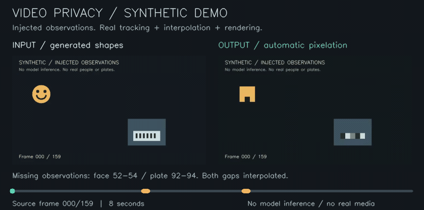

# Video Redaction Pipeline

A local video privacy-redaction pipeline for **faces and license plates**, combining pretrained detection, temporal tracking, bounded gap recovery, source-frame-accurate rendering, evaluation, and a **React human-review workspace**.

Built by **Anastasia Krnjaic** as an applied computer-vision engineering project around pretrained OpenVINO ADAS and Open Image Models YOLOv9 detectors.



This eight-second comparison uses fully programmatically generated video and injected synthetic observations with the real face and plate trackers, bounded tracker interpolation, and shared privacy renderer. It illustrates short-gap continuity; pretrained detector inference and the separate face privacy-gap-recovery stage are not run. No real person, plate text, third-party branding, or copied footage is shown. Detector performance is evaluated separately on the frozen benchmarks below; the [demo guide](docs/DEMO_GUIDE.md) explains how to generate the video and interactive review workspace.

Existing research footage, screenshots, model weights, review sessions, and delivery packages are intentionally excluded from Git. In particular, a finalized delivery package can contain Original media and should not be treated as a safe public download.

## What I Built

I built the practical processing and review pipeline around pretrained detectors. I did **not** train the OpenVINO ADAS or Open Image Models YOLOv9 models.

My implementation work covers:

- evaluating and selecting models for the recorded face and plate benchmarks;
- integrating detector preprocessing, inference, tiling, and source-bound outputs;
- linking observations into tracks and keeping weak, strong, and interpolated evidence distinct;
- recovering defensible short privacy gaps while surfacing uncertain intervals;
- mapping source frames through processing, review clips, corrections, and rendered output;
- implementing shared privacy rendering and decoded-output validation;
- building ground-truth annotation, evaluation, and evidence-validation tooling;
- developing the Python review backend and React/TypeScript frontend;
- supporting entity policies, human-confirmed merges, manual corrections, and reviewed revisions;
- preserving provenance through finalization and testing the workflow with synthetic fixtures and browser automation.

The project demonstrates applied computer-vision and software engineering: connecting imperfect model outputs to a reviewable result whose decisions can be inspected.

## Pipeline

```mermaid
flowchart LR
    A[Source video and frame identity] --> B[Face and plate detection]
    B --> C[Category tracking and temporal evidence]
    C --> D[Bounded gap recovery]
    D --> E[Shared privacy regions]
    E --> F[Automatic preview]
    F --> G[React review workspace]
    G --> H[Policies, merges and manual corrections]
    H --> I[Latest reviewed]
    I --> J[Full-video approval]
    J --> K[Immutable Final]
```



Python owns inference, temporal logic, privacy regions, sessions, rendering, validation, and finalization. React owns presentation, navigation, playback controls, and draft interaction state through the versioned backend API. Faces and plates have separate detector/tracker policies and share downstream rendering and review contracts.

**Temporal evidence with explicit limits.** The active face detector is OpenVINO `face-detection-adas-0001`: proposals are retained at `0.20`, while primary evidence starts at `0.30`. Plates use OIM YOLOv9-S-608 at `0.30` with uniform small-object tiles. Weak observations and interpolation cannot manufacture the real detector observations required for confirmation.

**Conservative gap handling.** Face recovery uses deterministic source-bound bridging; plate tracking uses accumulated evidence and bounded interpolation. Scene cuts, competing targets, implausible motion, and unsafe gaps remain auditable. Unsupported one-sided prediction is not silently promoted into automatic protection.

**Source-frame accuracy.** Regions, correction endpoints, and review intervals use explicit frame identities. Rendering validates media and checks that expected privacy regions change the intended decoded frames. Partial processing is distinguished from complete-source processing.

**Human review as part of the pipeline.** Reviewers inspect Guidance and Entities, choose policies, confirm merges, and add single-frame, fixed-interval, or interpolated corrections. Saved changes accumulate until an explicit **Build reviewed video** produces current Latest reviewed media. Finalization requires full-video approval of that exact revision. Human approval is preserved as human evidence.

**Traceable output.** Automatic observations remain separate from reviewed decisions. Append-only events, hashes, manifests, and immutable revisions link source input, effective regions, approval, and Final media. See the [system overview](docs/SYSTEM_OVERVIEW.md) for the implementation boundaries.

## Why Video Redaction Is Hard

A detector can miss an object for several frames because of motion blur, low light, occlusion, or scale changes. Independent frame predictions can make privacy masks flicker. Broadly filling every gap can hide unrelated content or bridge between different objects. A correct rectangle applied to the wrong source frame is also a privacy failure.

The central principle is **a detector proposal is evidence, not a final privacy decision**. Tracking and bounded recovery improve continuity, while human review handles unsupported intervals and corrections. The evidence records preserve which layer supplied each region instead of treating all redacted pixels as successful detections.

## Results

These are **raw detector recall** results on small, frozen, source-bound benchmarks. Tracking, recovered regions, and manual corrections receive no detector credit.

| Detector / target | Detected target-frames | Recall |
| --- | ---: | ---: |
| ADAS face, Day | 299 / 300 | 99.67% |
| ADAS face, standing Night | 359 / 360 | 99.72% |
| ADAS face, seated Night | 175 / 192 | 91.15% |
| **ADAS face, total at primary threshold 0.30** | **833 / 852** | **97.77%** |
| OIM plate, Day | 236 / 240 | 98.33% |
| OIM plate, Night | 321 / 360 | 89.17% |
| **OIM plate, total** | **557 / 600** | **92.8333%** |

The [face evidence](data/evaluations/face_detector_adas_v1.0/README.md) includes adjudication, input identities, thresholds, and validation. The [compact plate evidence](data/evaluations/plate_detector_oim_yolov9_s_608_v1/README.md) records the validated detector results and input hashes without distributing the videos. Frozen plate GT contains 600 reviewed spatial records. Complete spatial negative/ignore annotations are unavailable, so formal plate precision is not published.

These measurements support the evaluated clips, not a universal detector ranking. Private source assets are required to rerun their original inference. Current face reviewed-final numerical scoring is unsupported by its frozen contract; the product Day Final differs from the plate benchmark source. An older Night reviewed-final geometric result is labeled historical and is not assigned to current Final media. [Evaluation](docs/EVALUATION.md) explains these distinctions. No full-video zero-leak claim is made.

## Quick Start

### A. Asset-free developer smoke

Use Python 3.12, FFmpeg/FFprobe, Node.js, and npm. The tested environment and exact model prerequisites are in [Model setup](docs/MODEL_SETUP.md). From a fresh clone:

```bash
python3.12 -m venv .venv
source .venv/bin/activate
python -m pip install -e ".[dev]"
export PYTHONDONTWRITEBYTECODE=1
redactor doctor
python -m pytest -q -p no:cacheprovider \
  tests/test_plate_tracking.py::test_synthetic_video_smoke_without_model
npm --prefix frontend ci
npm --prefix frontend test
npm --prefix frontend run build
```

No private video, model weight, or OpenVINO installation is needed for this smoke. To generate the public-safe workflow demonstration after building the frontend:

```bash
python scripts/generate_synthetic_demo.py \
  --output artifacts/synthetic_demo --gif artifacts/synthetic_demo.gif
redactor serve-final-review-workspace \
  artifacts/synthetic_demo/case/review_workspace --open
```

The [demo guide](docs/DEMO_GUIDE.md) explains the synthetic observations, temporal gaps, review interaction, and generated files. It also documents intentional README-animation regeneration with `--gif docs/assets/video_redaction_demo.gif --overwrite-gif`. The server binds locally; use one writable server per workspace.

### B. Local real-video inference

Supply your own permitted `input.mp4`. Install the inference runtime, obtain the two active pretrained models separately, and verify **all three file hashes** using [Model setup](docs/MODEL_SETUP.md). Weights are not downloaded by the project install.

```bash
python -m pip install -e ".[dev,inference]"
redactor redact-video input.mp4 \
  --categories face,license_plate \
  --adas-xml models/face-detection-adas-0001/face-detection-adas-0001.xml \
  --adas-bin models/face-detection-adas-0001/face-detection-adas-0001.bin \
  --plate-model models/open-image-models/yolo-v9-s-608-license-plates-end2end.onnx \
  --output-dir artifacts/my_case
redactor serve-final-review-workspace artifacts/my_case/review_workspace --open
```

Use a new output directory. Inspect Automatic, save corrections, build Latest reviewed, and watch the complete current result before approving Final. Detailed review instructions are in [Final Review Workspace](docs/FINAL_REVIEW_WORKSPACE.md).

## Testing

The default public suite uses tracked synthetic fixtures and temporary outputs. It needs the Python development dependencies and FFmpeg/FFprobe, not models, private footage, or ignored release packages:

```bash
PYTHONDONTWRITEBYTECODE=1 python -m pytest -rs -p no:cacheprovider
python -m ruff check .
python -m ruff format --check .
npm --prefix frontend run typecheck
npm --prefix frontend run lint
npm --prefix frontend test
npm --prefix frontend run build
git diff --check
```

Backend workspace tests use small test-only frontend assets and never run an implicit npm install. The synthetic demo's media/API integration test runs after an explicit frontend build; without that build it reports a prerequisite skip, while its temporal unit tests still run.

Private release-lineage integration is explicitly optional and separate:

```bash
REDACTOR_RUN_LOCAL_ASSET_TESTS=1 PYTHONDONTWRITEBYTECODE=1 \
  python -m pytest -rs -p no:cacheprovider -m local_assets
```

The real Firefox smoke uses generated synthetic workspaces. Build the frontend first; provision Firefox with `python -m playwright install firefox` if it is not already installed, then run:

```bash
REDACTOR_RUN_FIREFOX_E2E=1 PYTHONDONTWRITEBYTECODE=1 \
  python -m pytest -rs -p no:cacheprovider tests/test_final_review_workspace_firefox.py
```

Browser tests are opt-in. Missing optional assets are not evidence that an integration test passed. Validation counts and environment details belong in [release evidence](docs/RELEASE_EVIDENCE.md).

## Project Structure

- `src/redactor/` — Python processing, evaluation, review, and finalization.
- `frontend/` — React/TypeScript application and frontend tests.
- `tests/fixtures/` — portable synthetic/sanitized test inputs.
- `data/ground_truth/` and `data/evaluations/` — versioned truth and compact evidence.
- `scripts/` — synthetic demo and engineering utilities.
- `docs/` — current architecture, setup, evaluation, and reviewer documentation.
- `docs/assets/` — generated synthetic visuals used by the README.
- `models/`, `data/raw/`, and `artifacts/` — ignored local inputs and generated output.

`docs/archive/`, `experiments/archive/`, `tests/archive/`, and `docs/system_overview_versions/` preserve historical research. They are not alternative supported detector setups.

## Limitations

Automated scope is faces and license plates. Other sensitive regions can be drawn manually; OCR and general identity recognition are not implemented. Low-light and difficult poses still cause misses. Entity-level rejection can remove valid protection if a mixed entity is misclassified. Guidance cannot expose every silent miss, so full-video review remains necessary. Processing and encoding can be expensive.

This is a local review application. Multi-user hosting and enterprise deployment are outside this portfolio scope. Model files and research media remain separate local inputs. A delivery package may include unredacted Original media, so neither finalization nor a redacted preview establishes permission to publish that package.

## Documentation

- **README** — start here.
- [System overview](docs/SYSTEM_OVERVIEW.md) — current architecture.
- [Evaluation](docs/EVALUATION.md) — ground truth, metrics, and claim boundaries.
- [Model setup](docs/MODEL_SETUP.md) — local inference dependencies and hashes.
- [Final Review Workspace](docs/FINAL_REVIEW_WORKSPACE.md) — reviewer workflow.
- [Demo guide](docs/DEMO_GUIDE.md) — safe generated demonstration.
- [Performance and production hardening](docs/PERFORMANCE_AND_PRODUCTION_HARDENING.md) — deeper engineering details.
- [Documentation inventory](docs/DOCUMENTATION_INVENTORY.md) — navigation and historical material.

## Licensing

This repository is published as a portfolio project. No open-source license is granted for the project source code. Third-party software and model components remain subject to their respective licenses.

See [third-party notices](THIRD_PARTY_NOTICES.md) for dependency attribution, pretrained models, and excluded media. The repository intentionally has no project-wide `LICENSE` file.
