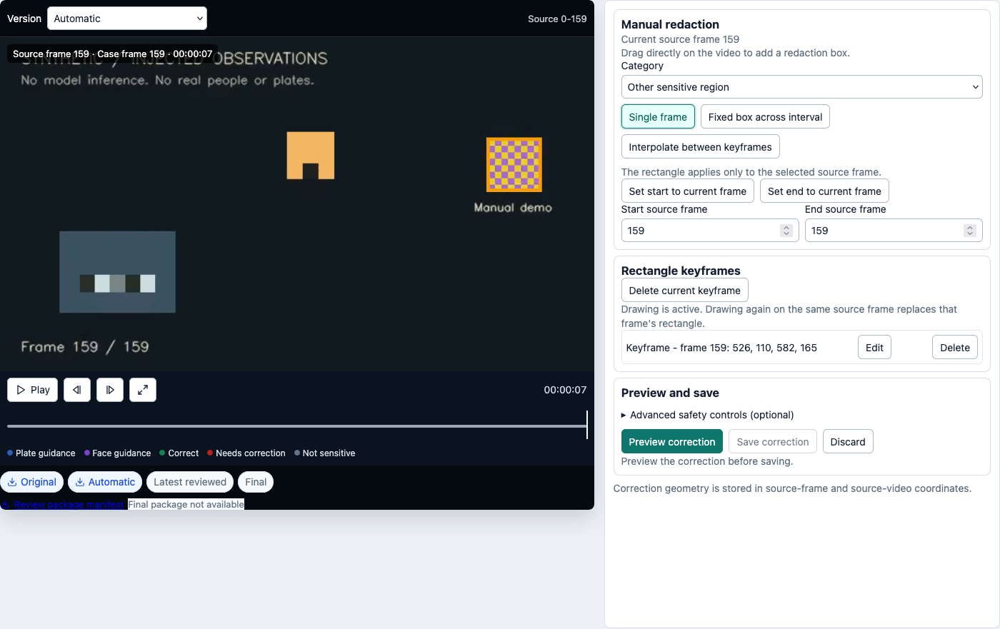

# Demo Guide

## Public-safe synthetic demo

The repository includes a small deterministic demo generator:
[`scripts/generate_synthetic_demo.py`](../scripts/generate_synthetic_demo.py).
It draws a moving cartoon face, a moving plate-like rectangle containing geometric
bars, and a checkerboard for a manual-correction exercise. There are no real
people, plate characters, third-party images, branding, or downloaded assets.

**The observations are injected fixtures, not detector predictions.** The demo
runs the existing face tracker, plate temporal-evidence tracker, bounded gap
interpolation, shared renderer, and review-workspace builder. It does not run
ADAS, OIM, optical-flow privacy recovery, or model evaluation. It demonstrates
downstream workflow behavior, not detector accuracy or real-video privacy quality.

The checked-in [`video_redaction_demo.gif`](assets/video_redaction_demo.gif) is an
840 × 416 INPUT/OUTPUT comparison of decoded synthetic source frames and actual
automatic-renderer output. It runs for eight seconds at 10 fps, sampling every
second frame of the 20 fps source without slowing playback. The gap labels and
timeline mark the precise omitted-observation frames; each gap lasts only 0.15
seconds. The manual checkerboard remains unredacted in Automatic on purpose.

### Generate and launch

First complete the Python setup in the [README](../README.md). The base Python
dependencies are sufficient; no detector runtime or model weights are needed.
FFmpeg and FFprobe must be installed and available on `PATH`. Build the frontend
once with Node.js/npm:

```bash
npm --prefix frontend ci
npm --prefix frontend run build
python scripts/generate_synthetic_demo.py --output artifacts/synthetic_demo \
  --gif artifacts/synthetic_demo.gif
redactor serve-final-review-workspace artifacts/synthetic_demo/case/review_workspace --open
```

The workspace generator requires an existing frontend build; it does not install
packages or download assets. It refuses a nonempty output directory and an existing
GIF destination unless `--overwrite-gif` is supplied. Use a fresh path to
repeat the demo without replacing a review session:

```bash
python scripts/generate_synthetic_demo.py --output /tmp/redaction-demo-new
redactor serve-final-review-workspace /tmp/redaction-demo-new/case/review_workspace --open
```

Default generated files live under ignored `artifacts/synthetic_demo/`. The public
repository includes the generator, tests and the compact synthetic GIF; source
videos, rendered MP4s, manifests and review sessions remain generated artifacts.
Geometry and observations are deterministic. Re-encoding the same input/output
pair with the same GIF toolchain is tested for byte-identical output; encoded
bytes across different toolchain versions and generated timestamps may vary.

### Regenerate only the public GIF

The same generator can skip frontend packaging. This mode still runs the real
trackers, validates the effective privacy-region plan, and invokes the same shared
automatic renderer with decoded media/region validation. It does not build a review
workspace or change production pipeline behavior.

Run from the repository root with a new temporary output directory:

```bash
demo_output="$(mktemp -d /tmp/video-redaction-demo.XXXXXX)"
PYTHONDONTWRITEBYTECODE=1 python scripts/generate_synthetic_demo.py \
  --output "$demo_output" --skip-workspace \
  --gif docs/assets/video_redaction_demo.gif --overwrite-gif
```

Only the explicitly requested GIF is written under `docs/assets/`; intermediate
videos, render records and validation remain in the temporary directory. No model,
image-generation service, browser, or external media is needed. Omitting
`--overwrite-gif` protects an existing destination from accidental replacement.

### Three-minute walkthrough

1. Start a review session with a demo reviewer name and open the generated case.
2. Compare **Original** and **Automatic**. Both retain the visible synthetic label.
3. Step through face frames **52–54** and plate frames **92–94**. The observations
   are deliberately absent, while accepted bounded interpolation supplies privacy
   regions. This illustrates continuity without counting interpolation as detection.
4. At frame **120**, open **Manual redaction**, choose **Other sensitive region**,
   and draw around the checkerboard at the upper right. For a quick exercise use
   **Single frame**. To cover its entire appearance, choose **Fixed box across
   interval**, frames **120–159**, with the same box.
5. Click **Preview**, inspect the rendered pixels, then **Save**. Select
   **Build reviewed video**, wait for the updated **Latest reviewed** media and inspect the saved correction. The suggested
   box in source pixels is `(526, 110, 582, 166)`; drawing it yourself demonstrates
   the human correction workflow.
6. Inspect **Audit Trail** and the linked correction verification task. Preview
   is transient; Save creates review provenance. This demo does not preapprove a
   full-video sweep or manufacture Final output.

The checkerboard intentionally has no automatic observations. It is a harmless
manual-only exercise, not an undocumented detector miss.

### Real review interface, synthetic media



This is the existing React interface served by the Python backend, displaying the
programmatically generated Automatic video at source frame 159. The outlined
checkerboard is an unsaved manual-correction draft; it has not been presented as
verified or finalized. The screenshot contains no real imagery, local paths, or
reviewer/session identifiers. No frontend code or displayed UI was altered for
capture.

### Generated evidence

| File under the output directory | Purpose |
| --- | --- |
| `synthetic_source.mp4` | 640 × 360, 160 frames, 20 fps, eight seconds, no audio; generated pixels only |
| `synthetic_demo.json` | Explicit synthetic provenance, omissions, source hash, manual exercise |
| `case/face/synthetic_observations_and_tracking.json` | Injected face boxes and tracking summary |
| `case/license_plate/synthetic_observations_and_tracking.json` | Injected plate boxes, evidence and gap decisions |
| `case/render_plan/effective_privacy_regions.jsonl` | Actual frame-indexed render input with synthetic provenance |
| `case/combined_preview/automatic_preview.mp4` | Actual shared-renderer output |
| `case/combined_preview/validation.json` | Decoded media/region validation from the existing renderer |
| `case/review_workspace/` | Runnable React/Python review workspace and local review sessions |

The workspace row is absent with `--skip-workspace`. An explicit `--gif` adds the
comparison at that destination and its dimensions, duration, byte count and SHA-256
to `synthetic_demo.json`. The GIF does not depict an approved Final or a saved
manual correction.

Pipeline profile IDs in generated manifests identify the configuration used by
the existing workspace contracts. They do **not** mean the named detector ran;
the detector stages explicitly record `skipped` and synthetic input provenance.
Do not cite the fixture's coverage/counts as benchmark results.

Validate the generator using temporary output:

```bash
PYTHONDONTWRITEBYTECODE=1 python -m pytest -q -p no:cacheprovider \
  --basetemp=/tmp/redaction-synthetic-tests tests/test_synthetic_demo.py
```

The workspace integration test needs FFmpeg/FFprobe and an already built frontend;
it skips if these prerequisites are absent. Temporal-fixture and generated-pixel
tests require no model/video assets. The GIF integration test needs FFmpeg/FFprobe
only: it checks actual rendered pixels during both gaps, eight-second playback,
frame count/dimensions, size, same-toolchain deterministic encoding, and destination
protection. The workspace test uses the real local API to Preview and Save a manual
correction.

## Real-video demonstration

Use your own recording or media with explicit permission for the intended use.
The local bodycam development clips and generated release packages are not public
demo assets. Consult [third-party notices](../THIRD_PARTY_NOTICES.md) and the
[local runbook](LOCAL_PRODUCTION_RUNBOOK.md) before working with real inputs.

After obtaining the selected models and validating their hashes:

```bash
redactor redact-video path/to/authorized-input.mp4 \
  --categories face,license_plate \
  --adas-xml models/face-detection-adas-0001/face-detection-adas-0001.xml \
  --adas-bin models/face-detection-adas-0001/face-detection-adas-0001.bin \
  --plate-model models/open-image-models/yolo-v9-s-608-license-plates-end2end.onnx \
  --output-dir artifacts/authorized_demo
redactor serve-final-review-workspace artifacts/authorized_demo/review_workspace --open
```

Show detector output, automatic coverage, reviewed corrections, current sweep
approval, and Final as separate stages. A full-video review is bound to the exact
Latest reviewed revision; subsequent media-affecting changes invalidate it.
Use a fresh/disposable workspace for interactive changes and preserve any frozen
evidence workspace unchanged. A finalization gate passing does not establish
permission to redistribute the source or prove universal zero leakage.
