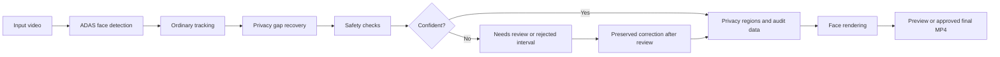

# Video Redaction Pipeline - System Overview

- **Document version:** v008
- **Last updated:** 2026-08-01
- **System status:** Face Pipeline v1 is integrated for ADAS face detection, ordinary tracking, privacy gap recovery, and face redaction rendering from accepted privacy regions. License-plate work is not part of the current completed pipeline.
- **Canonical document:** `docs/SYSTEM_OVERVIEW.md`

## What The System Is For

This repository builds a local video-redaction pipeline. Its current focus is face privacy: finding faces, keeping those detections connected over time, rendering accepted privacy regions, and clearly marking any interval that needs human review before it can be trusted for final redaction.

The system is not a finished automatic redaction product, and it does not make a universal zero-leak claim. It produces structured evidence, diagnostic outputs, non-final previews, and approved face-redacted MP4s when the available privacy-region evidence passes final safety gates.

## Current User Workflow

A user provides a local video clip and local ADAS model files. The supported face workflow is:

1. Run the face pipeline command.
2. Inspect detection, tracking, and privacy-gap artifacts.
3. Review intervals marked `needs_review` or `rejected`.
4. Preserve accepted corrections so they can be reused instead of regenerated.
5. Render a non-final preview or an approved final face-redacted MP4 from accepted privacy regions.

The main command is:

```bash
redactor face-pipeline INPUT_VIDEO \
  --adas-xml models/face-detection-adas-0001/face-detection-adas-0001.xml \
  --adas-bin models/face-detection-adas-0001/face-detection-adas-0001.bin \
  --output-dir artifacts/face_pipeline/RUN_NAME \
  --overwrite
```

Privacy gap recovery runs when target track IDs are supplied.

Rendering is a separate explicit step:

```bash
redactor render-faces INPUT_VIDEO \
  --privacy-regions artifacts/face_pipeline/RUN_NAME/privacy_gap_recovery/privacy_regions.jsonl \
  --interval-decisions artifacts/face_pipeline/RUN_NAME/privacy_gap_recovery/interval_decisions.json \
  --output-dir artifacts/face_pipeline/RUN_NAME/render_preview \
  --mode preview
```

## How The Pipeline Works



The stages are:

- **Face detection:** finds face proposals on individual frames.
- **Ordinary tracking:** connects proposals that appear to be the same face over time.
- **Privacy gap recovery:** tries to cover short or recoverable gaps in a redact target's track.
- **Safety checks:** prevent uncertain boxes from being treated as reliable.
- **Review preservation:** keeps accepted corrections so future runs do not have to rediscover them.
- **Face rendering:** applies blur or pixelation to accepted privacy regions on the original-resolution video.

## Why Detection Is Not Enough

A detector sees one frame at a time. It may temporarily lose a face when the person turns, lighting changes, the camera moves, the face is occluded, or the person is partly outside the frame.

For privacy work, a single missed frame can matter. That is why the pipeline separates raw detector observations from tracking and privacy recovery. A generated privacy box can help maintain coverage, but it is not counted as a detector hit.

## How Uncertain Intervals Are Handled

When the system sees a gap, it chooses the safest available recovery strategy:

- interpolate a short gap between reliable boxes;
- track forward and backward from reliable boxes on both sides;
- track from one side only when a gap touches a clip edge;
- preserve a previously accepted correction;
- mark the interval for review when evidence is not strong enough.

The system records an interval decision:

- `accepted_automatically`
- `accepted_after_refinement`
- `needs_review`
- `rejected`

The safer failure mode is review, not invented coverage. A gap that crosses a scene cut, jumps too far, changes size too much, overlaps a keep-person track, or moves near a competing identity should not be silently accepted.

Preview rendering can still be useful when review-required intervals exist, but it must remain non-final. Final rendering refuses export when relevant intervals need review, are rejected, contain unresolved privacy-required frames, or contain invalid boxes.

## Human Review And Preserved Corrections

Human review is part of the intended workflow. A reviewer can accept or correct privacy regions for difficult intervals. Once accepted, those regions can be supplied back to the pipeline as preserved regions.

Preserved corrections remain distinct from detector output and ordinary tracking output. This matters because each kind of evidence supports a different claim:

- a detector observation says the model saw a face proposal;
- ordinary tracking says proposals were linked over time;
- privacy recovery says a synthetic privacy region was generated or preserved;
- review says a human accepted or corrected an uncertain interval.
- rendering says accepted privacy regions were applied to video frames. It does not change the type of evidence that created each region.

## Current Face-Detector Decision

The active face detector is OpenVINO `face-detection-adas-0001`, recorded in outputs as `openvino_face_adas_0001`.

The selected detector policy is:

- proposal/storage floor: `0.20`;
- primary observation threshold: `0.30`;
- weak proposals from `0.20` through below `0.30` may support tracking but must not independently confirm a track.

The decision is backed by the tracked ADAS evidence record in `data/evaluations/face_detector_adas_v1.0/`.

OpenCV YuNet and OpenVINO `face-detection-0205` were historical comparison models. They are not active face detector backends and are not selectable in the supported face pipeline. The comparison history is preserved in `docs/archive/face_detector_bakeoff/`.

## Outputs And Audit Information

A face-pipeline run writes ignored artifacts under the selected output directory:

- `detection/`: frame-level ADAS detections, model hashes, timing, and optional overlay;
- `tracking/`: tracks, track quality, review flags, review windows, contact sheets, and overlay;
- `privacy_gap_recovery/`: privacy regions, interval decisions, metrics, source hashes, and optional overlay.
- render directory chosen by the user: face-redacted MP4, render manifest, summary, validation, processing log, and optional diagnostic comparison clip.

The render manifest records the source video hash, privacy-region input hash, rendering mode, redaction method, provenance counts, unresolved intervals, review status, output video hash, audio handling, and final approval status.

## Current Status

Implemented:

- media inspection, hashing, trimming, and contact sheets;
- ADAS face detection as the only active face detector;
- face tracking with weak and primary observations;
- privacy gap recovery with interval decisions and safety checks;
- preserved privacy-region support;
- face redaction rendering with preview and final approval modes;
- FFprobe validation of rendered media resolution, frame rate, duration, frame count, and audio presence;
- tracked ADAS detector evaluation evidence;
- historical archive for the detector bake-off.

Not yet implemented:

- complete analyst review workflow;
- machine-readable ground-truth conversion beyond the existing face benchmark files;
- automated evaluation runner;
- license-plate pipeline work.

## Known Limitations

- The system is not fully automatic.
- It does not guarantee perfect face coverage.
- Raw detector recall is not the same as tracking coverage or privacy-region coverage.
- Rendered face video quality is only as good as the accepted privacy-region evidence supplied to the renderer.
- Automatically recovered privacy regions must still be treated according to their interval decision.
- Universal or production-wide zero-leak claims have not been established.
- The evaluated detector decision applies to the current operating clips and evidence record; it is not a universal model ranking.

## Next Planned Stages

1. Complete review handling for face-track and privacy-gap decisions.
2. Expand validation of rendered face-only outputs before making broader redaction-quality claims.
3. Add automated evaluation only after current evidence and rendering semantics are stable.
4. Only after the face pipeline is coherent, resume separate license-plate detector work.

## Detailed Technical Notes

Implementation details, JSON output conventions, provenance fields, thresholds, safety gates, and diagnostic command notes live in `docs/FACE_PIPELINE_TECHNICAL_NOTES.md`.
