# Video Redaction Pipeline - System Overview

- **Document version:** v020
- **Last updated:** 2026-08-05
- **System status:** Face Pipeline v1 is integrated for full-video ADAS face detection, ordinary tracking, case-level privacy policy, privacy gap recovery, face redaction rendering from accepted privacy regions, automated evaluation against machine-readable face ground truth, and local Review Bundle packages. The prototype plate subsystem has one selected detector, Open Image Models YOLOv9-S-608, plus minimal temporal tracking, bounded gap recovery, non-final automatic plate previews, and a local plate review bundle.
- **Canonical document:** `docs/SYSTEM_OVERVIEW.md`

## What The System Is For

This repository builds a local video-redaction pipeline. Its most complete path is face privacy: finding faces, keeping those detections connected over time, rendering accepted privacy regions, measuring the result against available truth, and creating a compact review package for intervals that deserve human attention. License-plate work now has a selected detector, an initial continuity stage, non-final automatic previews from accepted tracks, and review bundles for gaps or uncertain plate-like tracks.

The system is not a finished automatic redaction product, and it does not make a universal zero-leak claim. It produces structured evidence, diagnostic outputs, non-final previews, and approved face-redacted MP4s when the available privacy-region evidence passes final safety gates.

## Current User Workflow

A user provides a local video clip and local ADAS model files. The supported face workflow is full-video by default:

1. Choose a case privacy policy. The safest default is `redact_all`.
2. Run the full-video command on the input video.
3. Inspect the track census and automatic preview.
4. Review intervals marked `needs_review`, `rejected`, or policy-unresolved.
5. Preserve accepted corrections so they can be reused instead of regenerated.
6. Export a final face-redacted MP4 only after blockers are resolved.
7. Evaluate benchmark clips against machine-readable face ground truth when Ground Truth exists.

The main command is:

```bash
redactor redact-video INPUT_VIDEO \
  --faces \
  --policy redact_all \
  --adas-xml models/face-detection-adas-0001/face-detection-adas-0001.xml \
  --adas-bin models/face-detection-adas-0001/face-detection-adas-0001.bin \
  --output-dir artifacts/cases/RUN_NAME \
  --overwrite
```

The normal workflow does not require target track IDs, benchmark frame windows, source-video-specific coordinates, or Ground Truth. Ground Truth is used only by the evaluator. Explicit keep-person choices are stored in the case privacy policy, not inferred from benchmark labels or visual roles.

The full-video command writes a non-final preview and a review bundle whenever blockers remain. Lower-level diagnostic commands such as `face-pipeline`, `recover-face-gaps`, and `render-faces` remain available for development, but they are not the primary production-oriented workflow.

Evaluation is also explicit:

```bash
redactor evaluate-faces \
  --ground-truth data/ground_truth/redaction_ground_truth_v1.0.json \
  --clip-id day_face \
  --mode reviewed_final \
  --source-video artifacts/eval_day_face.mp4 \
  --detections artifacts/adas_detector_integration_parity_v1/day_integrated.detections.jsonl \
  --adjudication data/evaluations/face_detector_adas_v1.0/adjudication.completed.corrected.json \
  --tracks artifacts/adas_integrated_tracking_validation_v1/runs/current_cli_default/day/tracks.jsonl \
  --privacy-regions artifacts/face_renderer_v1/day_face/recovery/privacy_regions.jsonl \
  --interval-decisions artifacts/face_renderer_v1/day_face/recovery/interval_decisions.json \
  --rendered-video artifacts/face_renderer_v1/day_face/render_final/redacted_final.mp4 \
  --render-manifest artifacts/face_renderer_v1/day_face/render_final/render_manifest.json \
  --render-validation artifacts/face_renderer_v1/day_face/render_final/validation.json \
  --output-dir artifacts/face_pipeline_evaluation_v1/day_reviewed_final
```

The review bundle command turns pipeline artifacts into a local HTML package:

```bash
redactor build-review-bundle \
  --source-video artifacts/eval_night_selective.mp4 \
  --case-id night_case_review_v1_2 \
  --privacy-regions artifacts/face_renderer_v1/night_auto_preview/recovery/privacy_regions.jsonl \
  --interval-decisions artifacts/face_renderer_v1/night_auto_preview/recovery/interval_decisions.json \
  --render-manifest artifacts/face_renderer_v1/night_auto_preview/render_preview/render_manifest.json \
  --automatic-preview-video artifacts/face_renderer_v1/night_auto_preview/render_preview/redacted_preview.mp4 \
  --evaluation-dir artifacts/face_pipeline_evaluation_v1/night_automatic \
  --corrected-privacy-regions artifacts/face_renderer_v1/night_reviewed_final/recovery/privacy_regions.jsonl \
  --corrected-interval-decisions artifacts/face_renderer_v1/night_reviewed_final/recovery/interval_decisions.json \
  --output-dir artifacts/review/night_case_review \
  --review-render-method pixelate \
  --review-margin-fraction 0.15 \
  --review-pixel-size 16
```

## How The Pipeline Works

```mermaid
flowchart LR
  A["Input video"] --> B["ADAS face detection"]
  B --> C["Ordinary tracking"]
  C --> D["Track census"]
  D --> E["Case privacy policy"]
  E --> F["Full-video privacy-region compiler"]
  F --> G["Privacy gap recovery and safety checks"]
  G --> H{"Confident?"}
  H -->|Yes| I["Privacy regions and audit data"]
  H -->|No| J["Needs review or rejected interval"]
  J --> K["Preserved correction after review"]
  K --> I
  I --> L["Face rendering"]
  L --> M["Preview or approved final MP4"]
  M --> N["Automated evaluation report"]
  N --> O["Local review bundle"]
```



The stages are:

- **Face detection:** finds face proposals on individual frames.
- **Ordinary tracking:** connects proposals that appear to be the same face over time.
- **Track census:** lists every auto-confirmed track, review candidate, weak sequence, and rejected proposal over the full processed video.
- **Case privacy policy:** assigns each track to `redact`, `keep`, `ignore`, or `review`.
- **Privacy-region compiler:** turns redacted tracks into full-video privacy regions and keeps unsupported assignments as review blockers.
- **Privacy gap recovery:** tries to cover short or recoverable gaps in each redacted track.
- **Safety checks:** prevent uncertain boxes from being treated as reliable.
- **Review preservation:** keeps accepted corrections so future runs do not have to rediscover them.
- **Face rendering:** applies blur or pixelation to accepted privacy regions on the original-resolution video.
- **Evaluation:** compares detector observations, tracking, privacy regions, preserved corrections, and render manifests against the selected machine-readable face ground truth.
- **Review bundle:** gathers risk items, benchmark-only failures, random audit samples, clips, contact sheets, and reviewer decision export into a local folder.

## Why Detection Is Not Enough

A detector sees one frame at a time. It may temporarily lose a face when the person turns, lighting changes, the camera moves, the face is occluded, or the person is partly outside the frame.

For privacy work, a single missed frame can matter. That is why the pipeline separates raw detector observations from tracking and privacy recovery. A generated privacy box can help maintain coverage, but it is not counted as a detector hit.

## Full-Video Privacy Policy

The supported default privacy policy is `redact_all`: every qualifying face track is assigned redaction across its evidence-supported lifetime. This default is deliberately conservative for arbitrary videos because the safest assumption is that every detected or temporally supported face should be protected.

A case can instead use `redact_all_except_keep` when the user explicitly marks one or more tracks as `keep`. A keep-person is a case-policy decision. It is not inferred from benchmark labels, clothing, role, position in the frame, or Ground Truth.

The policy compiler keeps evidence boundaries clear:

- auto-confirmed tracks and review-candidate tracks may produce privacy regions;
- rejected or unsupported candidates remain in the track census and review queue, but are not silently treated as valid automatic privacy regions;
- ambiguous keep-person fragments and unsupported weak sequences remain final-export blockers until reviewed;
- full-video redaction outside a benchmark range is reported separately and does not improve raw detector recall.

No system can prove that a face was never present if it produced no detector, tracker, recovery, review, or audit evidence. The workflow therefore keeps deterministic random audit samples and systematic review signals around track starts, track ends, gaps, scene changes, weak proposals, and intervals with little evidence.

## How Uncertain Intervals Are Handled

When the system sees a gap, it chooses the safest available recovery strategy:

- interpolate a short gap between reliable boxes;
- track forward and backward from reliable boxes on both sides;
- track from one side only when a gap touches a clip edge;
- preserve a previously accepted correction;
- mark the interval for review when evidence is not strong enough.

The system records an interval decision:

- `accepted_automatically`
- `accepted_after_refinement`
- `needs_review`
- `rejected`

The safer failure mode is review, not invented coverage. A gap that crosses a scene cut, jumps too far, changes size too much, overlaps a keep-person track, or moves near a competing identity should not be silently accepted.

Preview rendering can still be useful when review-required intervals exist, but it must remain non-final. Final rendering refuses export when relevant intervals need review, are rejected, contain unresolved privacy-required frames, or contain invalid boxes.

## Human Review And Preserved Corrections

Human review is part of the intended workflow. A reviewer can accept or correct privacy regions for difficult intervals. Once accepted, those regions can be supplied back to the pipeline as preserved regions.

Preserved corrections remain distinct from detector output and ordinary tracking output. This matters because each kind of evidence supports a different claim:

- a detector observation says the model saw a face proposal;
- ordinary tracking says proposals were linked over time;
- privacy recovery says a synthetic privacy region was generated or preserved;
- review says a human accepted or corrected an uncertain interval.
- rendering says accepted privacy regions were applied to video frames. It does not change the type of evidence that created each region.

## Automated Evaluation

The selected machine-readable ground truth is `data/ground_truth/redaction_ground_truth_v1.0.json`. It converts the frozen face portions of GroundTruth v1.1 into structured ranges without inventing tight per-frame boxes.

The evaluator has three modes:

- `detector`: raw ADAS detector observations only;
- `automatic`: detector, ordinary tracking, and automatically accepted privacy recovery, excluding preserved or manual reviewed corrections;
- `reviewed_final`: includes explicitly reviewed or preserved corrections and can validate the final rendered video manifest and media checks.

The evaluator keeps these claims separate. A reviewed correction can complete a final privacy-region result, but it does not improve raw detector recall. A renderer approval says the renderer accepted and applied its input regions; it is not, by itself, proof that the regions match ground truth.

## Automated Review Bundles

After processing or evaluation, the system can build a local review bundle. The bundle is meant to save reviewer time: it selects short intervals that look risky, creates contact sheets and short clips, and presents a guided task list in `index.html`.

The bundle keeps two layers:

- **Raw signals:** every pipeline, rendering, evaluation, and Ground-Truth event the system used to build the bundle.
- **Reviewer tasks:** concise human actions created by grouping related raw signals into a smaller queue.

Raw signals come from three sources:

- **Pipeline-derived risk:** review-required or rejected intervals, unresolved frames, invalid boxes, suspicious provenance changes, tracking fragmentation, render or media validation failures, and similar signals.
- **Ground-Truth-derived benchmark evidence:** known detector misses, uncovered privacy-required frames, or keep-person false redaction when machine-readable Ground Truth and evaluator outputs are available.
- **Random audit samples:** deterministic samples from apparently normal intervals, used to reduce the chance that silent problems are missed.

The review bundle never proves that no face was missed. On a new production video, Ground Truth usually does not exist, so the bundle can only show risks the pipeline can infer plus random audit samples.

The default page shows required tasks first, then corrected-result confirmations, optional spot checks, and a separate Technical audit. Technical-only signals remain available, but they do not inflate the default task count.

Review Bundle v1.2.3 renders comparison clips from the same source-frame interval. Original is unredacted source context. Automatic is the automatic privacy-region set rendered over that interval. Corrected final is the reviewed/corrected privacy-region set rendered over the same interval with the same visual method. This prevents a reviewer from mistaking a blur-versus-pixelation difference for a privacy-region difference.

The bundle also checks the actual decoded video frames. A clip can have plausible media metadata but still fail in a browser if it was encoded with an unsuitable video stream. Review clips are therefore written as browser-compatible H.264/yuv420p MP4s, decoded after generation, sampled at the beginning, middle, and end, and compared with the matching source frames. If a generated clip turns black while the source is visibly structured, bundle generation fails instead of publishing a misleading review page.

Short review clips have local frame numbers that start at zero, while privacy-region JSON keeps the original source-video frame numbers. The bundle records the source-to-local mapping and verifies that each expected privacy box visibly changes the intended decoded frame. A review clip is not accepted merely because a JSON region exists; the rendered pixels must confirm that the region was applied to the right frame.

The HTML page stores temporary reviewer choices in browser-local state and provides an explicit export button for a decisions JSON file. Exported decisions identify the reviewer task, the underlying raw signal IDs, the selected plain-language action, the machine-readable status, and the media role reviewed. They can be validated against the original queue, but they do not directly rewrite privacy regions or override renderer/evaluator approval. If an interval still lacks valid reviewed privacy regions, final export remains blocked.

A random audit sample is optional only until a reviewer finds a missed privacy target. That finding is recorded separately from Ground Truth and can be supplied to the bundle as reviewer-discovered evidence. The bundle then promotes the interval to a blocking corrected-result task while preserving the original random sample in the Technical audit. This matters because benchmark coverage can be true for the selected annotated window while a random whole-video sample still reveals a privacy issue elsewhere in the clip.

For reliable embedded video playback, bundles can be served locally with `redactor serve-review-bundle BUNDLE_DIRECTORY --open`. The server binds to `127.0.0.1`, serves only files under the selected bundle directory, and makes no external network calls. Direct `file://` opening remains available as a fallback, but the page recommends localhost serving when browser playback is unreliable.

## Current Face-Detector Decision

The active face detector is OpenVINO `face-detection-adas-0001`, recorded in outputs as `openvino_face_adas_0001`.

The selected detector policy is:

- proposal/storage floor: `0.20`;
- primary observation threshold: `0.30`;
- weak proposals from `0.20` through below `0.30` may support tracking but must not independently confirm a track.

The decision is backed by the tracked ADAS evidence record in `data/evaluations/face_detector_adas_v1.0/`.

OpenCV YuNet and OpenVINO `face-detection-0205` were historical comparison models. They are not active face detector backends and are not selectable in the supported face pipeline. The comparison history is preserved in `docs/archive/face_detector_bakeoff/`.

## Current Plate-Detector Decision

The active plate detector is Open Image Models YOLOv9-S-608, recorded in outputs as `oim_yolov9_s_608`.

The selected detector policy is:

- inference mode: `uniform_small_object_tiles`;
- primary threshold: `0.30`;
- no separate lower proposal threshold selected for the active detector.

OIM was selected after finalist metrics and manual full-video visual adjudication. RT-DETR had higher recall, but it produced many more true non-plate detections and duplicates. For redaction, cleaner localization and lower false redaction burden matter because every false plate box can hide unrelated scene content and increase review workload.

The decision is backed by `data/evaluations/license_plate_detector_oim_yolov9_s_608_v1/`. Historical OpenVINO 0106/0123, Intel YOLOv8n, RF-DETR, RT-DETR, and LPD-YuNet experiments are preserved in `docs/archive/license_plate_detector_bakeoff/`.

The plate tracker now connects OIM detections into deterministic temporal tracks, rejects isolated noise, and interpolates only short two-anchor gaps that pass motion, scale, and scene-cut checks. Longer gaps, unstable tracks, and possible static-overlay false positives remain review evidence.

Plate Rendering and Review v1 can create a clean automatic preview from accepted plate tracks only. It uses pixelation with one global 15% margin, preserves detector-versus-tracker provenance, validates that expected regions changed in decoded output frames, and builds a local review bundle for unresolved gaps, uncertain tracks, possible false accepted tracks, and deterministic spot checks. The preview is not final plate approval; reviewed correction intake and unified face/plate rendering remain later work.

## Outputs And Audit Information

A full-video face-policy run writes ignored artifacts under the selected output directory:

- `source_manifest.json`: source video hash, frame count, FPS, and dimensions;
- `privacy_policy.json`: case policy, full source span, track assignments, provenance, and unresolved assignments;
- `track_census.json` and `track_gallery/`: full-video track census and compact local gallery;
- `detection/`: frame-level ADAS detections, model hashes, timing, and optional overlay;
- `tracking/`: tracks, track quality, review flags, review windows, contact sheets, and overlay;
- `privacy_regions/`: compiled privacy regions, interval decisions, summary, source hashes, and policy/recovery metrics;
- `automatic_preview/`: non-final face-redacted preview, render manifest, summary, validation, and processing log;
- `review/`: local HTML review bundle, queue/task JSON, media audit JSON, local CSS/JS, clips, contact sheets, checklist, and decision template/export files;
- `final/`: either a final render or a machine-readable blocked status;
- `audit_manifest.json`: links source, policy, tracking, privacy, rendering, review, and final status.

Diagnostic commands may also write targeted `privacy_gap_recovery/`, render, evaluation, or review directories chosen by the user.

The render manifest records the source video hash, privacy-region input hash, rendering mode, redaction method, provenance counts, unresolved intervals, review status, output video hash, audio handling, and final approval status.

## Current Status

Implemented:

- media inspection, hashing, trimming, and contact sheets;
- ADAS face detection as the only active face detector;
- face tracking with weak and primary observations;
- full-video face track census and machine-readable case privacy policy;
- `redact_all` as the default full-video face privacy policy;
- explicit `redact_all_except_keep`, `redact_selected`, and `review_only` policy modes;
- full-video privacy-region compilation without target track IDs, frame windows, or Ground Truth;
- privacy gap recovery with interval decisions and safety checks;
- preserved privacy-region support;
- face redaction rendering with preview and final approval modes;
- machine-readable face ground truth derived from frozen GroundTruth v1.1;
- automated face evaluation in detector, automatic, and reviewed-final modes;
- automated local Review Bundle v1.2.3 with raw signal preservation, concise reviewer tasks, guided review and auto-advance, reviewer-discovered random-audit miss promotion, loopback bundle serving, aligned same-style local media comparison, decoded-frame visual-content checks, source-to-local frame mapping, bbox-localized rendered-region validation, deterministic audit samples, media provenance audit, and exported-decision validation;
- FFprobe validation plus decoded-frame validation of rendered media resolution, frame rate, duration, frame count, audio presence, visible content, browser-compatible encoding, and expected region application;
- tracked ADAS detector evaluation evidence;
- selected OIM YOLOv9-S-608 plate detector workflow;
- prototype plate tracking and bounded short-gap recovery with review intervals;
- non-final plate preview rendering from accepted tracks plus a local plate review bundle;
- historical archives for face and plate detector bake-offs.

Not yet implemented:

- correction UI for drawing or editing privacy regions;
- robust automatic identity grouping for all keep-person fragments;
- reviewed plate-correction intake and final unified face/plate rendering.

## Known Limitations

- The system is not fully automatic.
- It does not guarantee perfect face coverage.
- Raw detector recall is not the same as tracking coverage or privacy-region coverage.
- Machine-readable face ground truth is range-level for the evaluated clips; it does not provide tight per-frame boxes for IoU scoring.
- Automated evaluation does not perform pixel-level rendered privacy verification.
- Automated review queues cannot detect every possible silent missed face, especially without Ground Truth.
- Full-video policy can mark unsupported candidates for review, but it does not prove that unsupported weak detections are real faces.
- `redact_all_except_keep` depends on explicit keep-track selection and may require review when the keep identity is fragmented or ambiguous.
- The review bundle records decisions, but it does not draw boxes or create corrected privacy regions.
- Rendered face video quality is only as good as the accepted privacy-region evidence supplied to the renderer.
- Automatically recovered privacy regions must still be treated according to their interval decision.
- Universal or production-wide zero-leak claims have not been established.
- The evaluated face and plate detector decisions apply to the current operating clips and evidence records; they are not universal model rankings.
- Plate previews are not final plate approval. OIM has known gaps, and the tracker leaves long or unsafe gaps as review-required evidence instead of silently inventing boxes.

## Next Planned Stages

1. Add a correction workflow that can supply reviewed privacy regions for review-required intervals.
2. Expand validation of rendered face-only outputs before making broader redaction-quality claims.
3. Add reviewed plate-correction intake for unresolved plate intervals.
4. Add unified face/plate rendering only after plate corrections are reviewed.

## Detailed Technical Notes

Face implementation details, JSON output conventions, provenance fields, thresholds, safety gates, and diagnostic command notes live in `docs/FACE_PIPELINE_TECHNICAL_NOTES.md`. Plate detector and tracking details live in `docs/PLATE_PIPELINE_TECHNICAL_NOTES.md`.
